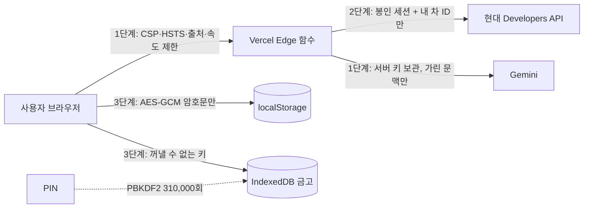

# 🔐 보안 설계 — 3단계 방어 (Defense in Depth)

> **목표** 내 차의 상태는 **나만** 볼 수 있고, 대화 기록·일기장·개인정보는 **내 기기 밖으로 평문으로 나가지 않는다.**
>
> 기존 기능은 그대로 두고, 그 위에 서로 다른 성격의 방어선 세 겹을 덧씌웠습니다.
> 한 겹이 뚫려도 다음 겹이 막도록 설계했고, 모든 핵심 주장은 자동 테스트로 증명합니다(`npm run verify`).

| 단계 | 지키는 곳 | 핵심 기술 | 막는 공격 |
|---|---|---|---|
| **1단계 · 관문** | 브라우저 ↔ 서버 경계 | CSP · HSTS · 출처 검사 · 속도 제한 · 요청 크기 제한 · 비밀값 검사 CI | XSS, 클릭재킹, CSRF, 남용(DoS·비용 폭탄), 키 유출 |
| **2단계 · 주인 확인** | 서버 ↔ 현대 차량 API | OAuth 2.0 + PKCE(S256) · AES-256-GCM 봉인 세션 쿠키 · 차량 ID 바인딩 | 남의 차 조회(BOLA/IDOR), 세션 탈취·위조, 토큰 노출 |
| **3단계 · 내 기기 금고** | 브라우저 저장소 · AI 전송 | AES-256-GCM 저장 암호화 · PBKDF2 PIN 잠금 · 개인정보 가리기 | 기기 분실·공용 PC, 저장소 탈취, AI로의 개인정보 유출 |



---

## 1단계 · 관문 (Edge / Transport)

| 통제 | 구현 | 위치 |
|---|---|---|
| **콘텐츠 보안 정책(CSP)** | `script-src 'self'` — 인라인·`eval` 금지, 외부 스크립트는 버전 고정된 1곳만. `object-src 'none'`, `base-uri 'self'`, `frame-ancestors 'none'` | `security/policy.mjs` |
| **단일 정책 원본** | 같은 정책을 ① Vercel 응답 헤더 ② 빌드된 `index.html`의 `<meta>`(GitHub Pages용)로 동시에 내보냄. 어긋나면 CI 실패 | `vite.config.ts`, `scripts/sync-headers.mjs` |
| **전송 보안** | HSTS 2년 + 하위 도메인 + preload, `upgrade-insecure-requests` | 〃 |
| **브라우저 격리** | `X-Frame-Options: DENY`, `nosniff`, `Referrer-Policy: strict-origin-when-cross-origin`, `Cross-Origin-Opener-Policy: same-origin` | 〃 |
| **권한 최소화** | `Permissions-Policy`: 카메라·결제·USB 금지, 마이크·위치는 이 사이트만 | 〃 |
| **API 공통 경비원** | 모든 서버 함수가 `guard()` 하나를 통과: 허용 출처 목록 + `Sec-Fetch-Site` 검사, 메서드 제한, 함수별 분당 요청 수(슬라이딩 윈도), 요청 크기 상한, `no-store`, 요청 ID, 내부 오류 메시지 숨김 | `api/_lib/http.ts` |
| **비밀값 유출 방지** | 커밋되는 모든 파일에서 Google·OpenAI·GitHub·AWS 키, 개인 키, JWT 모양 검사 + `.env`·토큰 파일 자체 차단 | `scripts/scan-secrets.mjs` |
| **공급망** | `npm audit`(high 이상 실패), Dependabot 주간 업데이트, CodeQL `security-extended` 정적 분석 | `.github/` |

함수별 속도 제한: 차량 API 60/분 · 로그인 20/분 · 대화 AI 12/분(상태 확인은 별도 60/분) · 실시간 음성 토큰 6/분.

## 2단계 · 주인 확인 (Owner-only Vehicle Access)

**"차량 상태는 나 이외 아무도 확인 불가능"** 을 서버에서 강제합니다.

1. **OAuth 2.0 Authorization Code + PKCE(S256)**
   `state`(CSRF 방지)와 `code_verifier`는 서버 비밀키로 봉인한 단기 쿠키(10분)에만 존재. 콜백에서 **상수 시간 비교**로 확인.
2. **봉인 세션 쿠키** — 토큰은 브라우저 JavaScript가 절대 볼 수 없음
   - `SESSION_SECRET` → **HKDF-SHA-256** → 용도별 키 분리(세션 / OAuth)
   - **AES-256-GCM**, 용도 문자열을 AAD로 묶어 다른 쿠키로 바꿔치기 불가
   - `__Host-` 접두사(도메인 고정·HTTPS 전용) + `HttpOnly` + `Secure` + `SameSite=Lax`(로그인 복귀 리다이렉트 허용, 다른 사이트의 요청에는 안 실림)
   - 절대 만료 12시간 · 유휴 만료 2시간 · 요청마다 재봉인(회전)
3. **차량 ID 바인딩 (BOLA/IDOR 차단 — OWASP API Top 10 #1)**
   로그인 순간 현대 API의 *내 차 목록*에서 차량 ID를 뽑아 세션에 봉인. 이후 모든 요청은
   - 허용된 경로 패턴(`carlist`, `status/{carId}/…`)만 통과, 그 외 **404**
   - 세션에 없는 차량 ID면 **403** — URL을 바꿔 남의 차를 조회할 수 없음
   - `../`, `%2f` 같은 경로 조작 거부
4. **CSRF 이중 방어** — `SameSite` 쿠키 + 사용자 정의 헤더(`X-OCA-Request: 1`, 다른 사이트의 폼·이미지 태그로는 못 보냄) + 동일 출처 검사
5. **개발 서버도 동일 원칙** — 로컬 개발 서버의 토큰 파일은 권한 `0600`, 주인 쿠키가 있는 브라우저에서만 조회 가능

검사 순서(`api/car.ts`): 경비원 → CSRF 헤더 → 세션 유효성 → 경로·소유 확인 → 현대 API 호출.

## 3단계 · 내 기기 금고 (On-device Privacy)

**대화 기록 · 일기장 · 차량 기록 · 사용자 설정**은 저장되는 순간 암호화됩니다.

| 통제 | 구현 |
|---|---|
| **저장 암호화** | 모든 `oca.*` 저장 값 → **AES-256-GCM**(96비트 무작위 IV), 저장 칸 이름을 **AAD**로 묶어 칸끼리 암호문 바꿔치기 불가 (`src/security/secureStorage.ts`) |
| **꺼낼 수 없는 키** | 데이터 키(DEK)는 WebCrypto `extractable: false` 로 생성해 IndexedDB에 보관 — 스크립트도 키 원본을 읽을 수 없음 (`src/security/vault.ts`) |
| **PIN 잠금(선택)** | PIN → **PBKDF2-SHA-256 310,000회**(OWASP 2023 권장) → 키 암호화 키(KEK) → **AES-KW**로 DEK 포장. PIN을 켜면 포장 안 된 키는 삭제 |
| **무차별 대입 방어** | 5회 실패부터 30초·60초·… 지수 대기, **10회 실패 시 금고 파기(crypto-shredding)** — 키가 사라지면 암호문은 영구히 복구 불가 |
| **자동 잠금** | 앱이 3분 이상 화면에서 사라지면 메모리의 키를 버리고 잠금 |
| **무중단 이전** | 예전 평문 데이터는 첫 실행 때 자동으로 암호화로 바뀜(기존 사용자 데이터 보존) |
| **AI 전송 전 개인정보 가리기** | 주민번호·전화번호(국제 형식 포함)·이메일·카드번호(Luhn 검증)·계좌번호·차대번호(VIN)·번호판·상세 주소를 `[전화번호]` 같은 표식으로 바꿈. 위치 좌표는 소수 2자리(약 1km)로 흐림 (`src/security/redact.ts`) |
| **삭제할 권리** | 설정 › 내 정보 보호 › *내 데이터 완전 삭제* — 키와 모든 기록을 지움 (개인정보 보호법 제36조) |

## 위협 모델 (STRIDE)

| 위협 | 시나리오 | 대응 단계 |
|---|---|---|
| **S**poofing 위장 | 남이 내 세션 쿠키를 만들어 냄 | 2 — AES-GCM 봉인, 위조 시 복호화 실패 |
| **T**ampering 변조 | 저장된 일기 암호문을 다른 칸에 붙여 넣음 | 3 — AAD 불일치로 거부·폐기 |
| **R**epudiation 부인 | 이상 요청 추적 불가 | 1 — 모든 응답에 요청 ID |
| **I**nformation disclosure 유출 | URL의 차량 ID를 바꿔 남의 차 위치 조회 | 2 — 세션 바인딩 차량 ID 외 403 |
| 〃 | 공용 PC에서 일기·대화 열람 | 3 — 암호화 + PIN + 자동 잠금 |
| 〃 | AI 회사로 전화번호·주소 전송 | 3 — 개인정보 가리기 |
| **D**enial of service | 대화 AI 무한 호출로 비용 폭탄 | 1 — 함수별 속도·크기 제한 |
| **E**levation of privilege | 주입된 스크립트(XSS) 실행 | 1 — 엄격한 CSP, 인라인·eval 금지 |

## 표준 대응표

| 기준 | 항목 | 본 프로젝트 |
|---|---|---|
| OWASP Top 10 (2021) | A01 접근 통제 실패 | 차량 ID 바인딩, 경로 허용 목록 |
| | A02 암호화 실패 | AES-256-GCM, HKDF, PBKDF2 310k, HSTS |
| | A03 주입 | CSP, 서버 입력 길이·제어문자 정리 |
| | A05 보안 설정 오류 | 단일 정책 원본 + CI 일치 검사 |
| | A06 취약한 구성요소 | npm audit, Dependabot, CodeQL |
| | A07 인증 실패 | PKCE, state 상수 시간 비교, 세션 만료·회전 |
| OWASP API Top 10 (2023) | API1 BOLA | 403 테스트로 증명 |
| | API4 자원 소비 제한 없음 | 속도·크기 제한 |
| 개인정보 보호법 | 제3조 최소 수집 | AI 전송 전 가리기, 좌표 흐리기 |
| | 제29조 안전조치 | 저장 암호화, 접근 통제 |
| | 제36조 삭제 | 완전 삭제 버튼(crypto-shredding) |

## 직접 확인하기

```bash
npm run verify     # 타입 검사 → 보안 테스트 → 비밀값 검사 → 헤더 일치 → 의존성 취약점
```

| 테스트 파일 | 증명하는 것 |
|---|---|
| `tests/crypto.test.ts` | 암호문 변조·다른 AAD·다른 키·틀린 PIN은 모두 열리지 않음 |
| `tests/secureStorage.test.ts` | 저장소에는 암호문만, 평문 자동 이전, 칸 바꿔치기 폐기, 키 교체 |
| `tests/session.test.ts` | 쿠키 위조·용도 바꿔치기·만료·짧은 비밀키 거부 |
| `tests/oauth.test.ts` | PKCE S256 정확성(Node 표준 구현과 교차 검증), 남의 차 403, 경로 조작 거부 |
| `tests/api.test.ts` | 실제 차량 API 함수에 공격 요청: 세션 없음·다른 출처·헤더 없음·남의 차·POST |
| `tests/redact.test.ts` | 개인정보 8종 가리기, 날짜·차 상태 숫자는 보존 |
| `tests/headers.test.ts` | 배포 헤더 = 정책 원본, 위험한 CSP 허용 없음 |

브라우저에서: 개발자 도구 › Application › Local Storage를 열면 `oca.*` 값이 모두 `v1.…` 암호문입니다.

## 배포 설정 (Vercel 환경 변수)

| 이름 | 설명 |
|---|---|
| `SESSION_SECRET` | **32바이트 이상** 무작위 값. 예: `node -e "console.log(require('crypto').randomBytes(48).toString('base64url'))"` |
| `HYUNDAI_CLIENT_SECRET` | 현대 Developers 클라이언트 비밀키 (서버 전용) |
| `HYUNDAI_REDIRECT_URI` | `https://<도메인>/callback` |
| `HYUNDAI_PKCE` | 현대 인증 서버가 PKCE를 지원하면 `1` |
| `GEMINI_API_KEY` | 대화 AI 키 (서버 전용, 브라우저로 나가지 않음) |

비밀값은 `.env.local` 또는 Vercel 대시보드에만 두고, 저장소에는 절대 넣지 않습니다(CI가 검사).

## 알려진 한계 (정직한 공개)

- **속도 제한은 서버 인스턴스별 메모리**입니다. 여러 지역 인스턴스를 합친 전역 제한은 Redis/KV 같은 공유 저장소가 필요합니다.
- **새로고침 토큰 흐름은 아직 없습니다.** 현대 토큰이 만료되면 다시 로그인합니다(더 짧은 노출 시간이라는 장점도 있음).
- **PKCE는 선택 사항**입니다(`HYUNDAI_PKCE=1`). 인증 서버가 지원하는지 확인 후 켭니다.
- **XSS가 성공하면** 꺼낼 수 없는 키라도 그 세션 동안은 *사용*될 수 있습니다. 그래서 1단계 CSP가 첫 번째 방어선입니다.
- **실시간 음성 대화의 소리 자체**는 가릴 수 없습니다. 함께 보내는 텍스트 문맥만 가립니다.
- PIN을 켜지 않으면 기기 접근 권한이 있는 사람은 앱을 열 수 있습니다(저장소 파일 직접 탈취는 여전히 암호문).

## 취약점 제보

보안 문제를 발견하시면 공개 이슈 대신 GitHub의 **Security › Report a vulnerability**(비공개 제보)로 알려 주세요.
